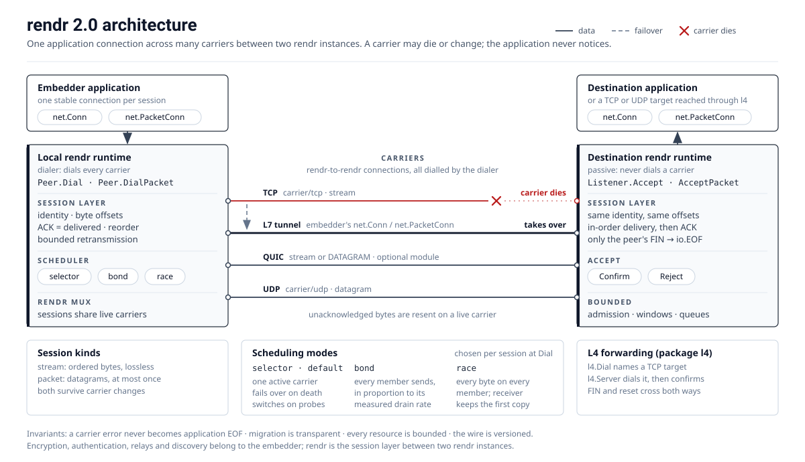

# rendr

rendr is a Go library that keeps one application connection alive across
many underlying connections ("carriers") between two rendr instances. It is
a userspace session layer: the application holds one ordinary connection,
and rendr moves its traffic between carriers without the application
noticing.

## How it works

Every session has two ends, each in its own rendr instance: the dialer,
which opens the session and dials every carrier, and the passive end, which
accepts it. The application on each side sees one connection, a `net.Conn`
for a stream session or a `net.PacketConn` for a packet session, whose
addresses stay the same whichever carriers are in use.

Underneath, rendr keeps each session's identity and byte offsets. It
acknowledges data only once it has been delivered to the receiving
application, retransmits within bounded windows, restores stream order, and
moves traffic to another carrier when one dies, degrades or is replaced. A
carrier failure never reaches the application as an error, a reset or an end
of stream: only the peer's real end of stream is `io.EOF`. If no carrier is
left for a bounded grace period, the session fails with an explicit error.

A packet session carries datagrams instead of a byte stream: each datagram
is delivered at most once, possibly out of order, and never retransmitted.
Changing carriers is as invisible as for a stream session.

A carrier may cross relays or proxies; rendr treats them as opaque pipes, so
its guarantees cover the whole path from end to end.

## Concepts

| Term | Meaning |
|---|---|
| Instance | One running rendr, identified by a random instance ID. |
| Session | One application connection carried by rendr. Its identity outlives every carrier. A **stream session** carries a byte stream; a **packet session** carries datagrams. |
| Carrier | One rendr-to-rendr connection under a session: plaintext TCP (`carrier/tcp`), plaintext UDP (`carrier/udp`), QUIC (the `quic/v2` module), or the embedder's own tunnel handed over as a `net.Conn` or `net.PacketConn`. |
| Dialer / passive end | The dialer opens sessions, dials the carriers and chooses how they are used; the passive end accepts and confirms or rejects each session, and never dials. |
| Selector | One active carrier at a time; fail over when it dies, switch for quality only on measured evidence. |
| Bond | Every carrier carries data at once, for combined throughput. |
| Race | Every byte or datagram goes on every carrier and the receiver keeps the first copy, for the lowest latency. |
| Mux | Many sessions share the same live carriers. |
| Fate group | Carriers that fail together, such as two paths through one relay; rendr spreads its choices across groups. |
| L4 forwarding | Package `l4` carries TCP connections over stream sessions. |

## What rendr is not

- Not a VPN or L3 tunnel, and it does not use one as a carrier.
- No encryption or authentication of its own; securing the carriers is the
  embedder's job.
- No proxy protocols, relays, mesh or node discovery.
- No conversion between byte streams and datagrams.
- No kernel data plane: the core is userspace and portable.

## Compatibility

rendr 2.x speaks wire format version 2, frozen at 2.0.0 and extended later
only in ways that keep every 2.x peer interoperable. It does not interoperate
with rendr v0.x or v1.

## Module and license

`github.com/FrankoonG/rendr/v2` depends only on the standard library and
`golang.org/x/sys`; `github.com/FrankoonG/rendr/quic/v2` holds the QUIC
carriers. Both require Go 1.26.3 or later.

Licensed under the GNU General Public License v3.0; see [LICENSE](LICENSE).
The session core began as a port of `internal/msess` from the same author's
hy2scale project, also under GPL-3.0.
